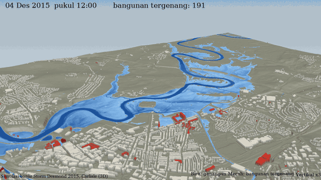
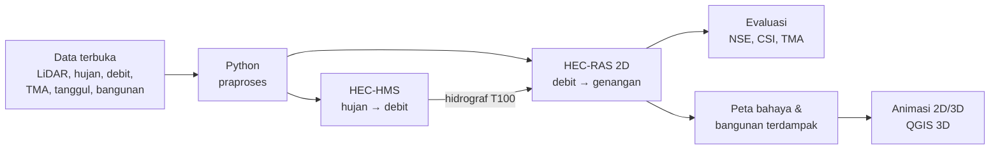
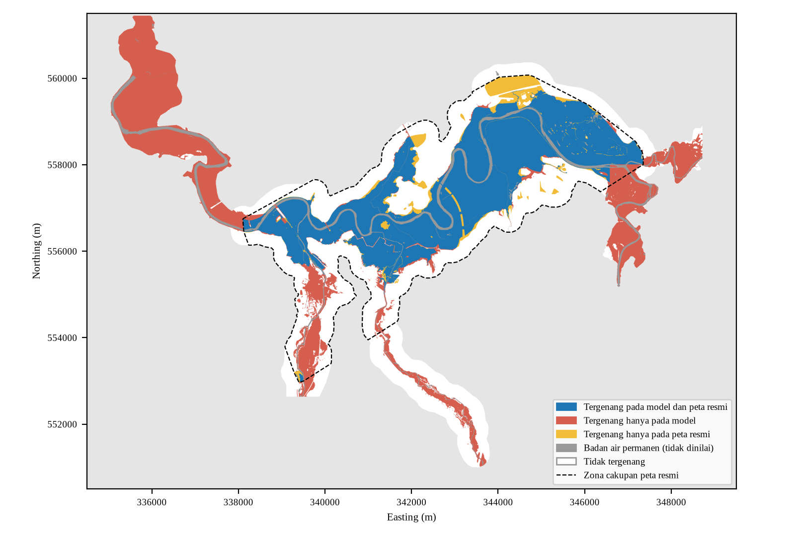
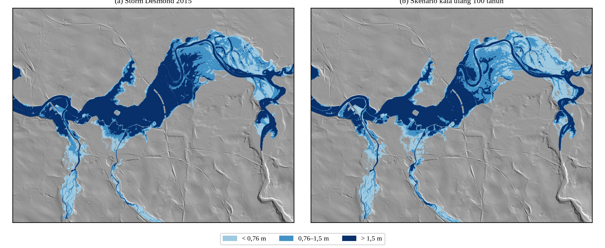
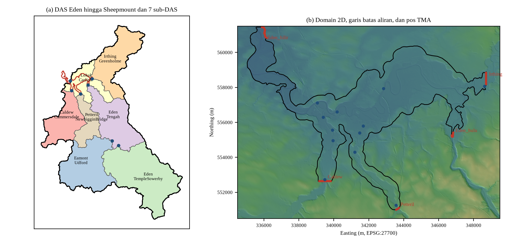
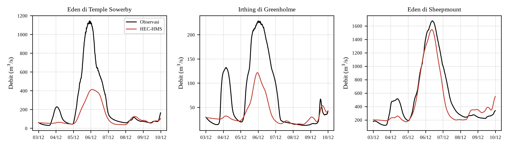
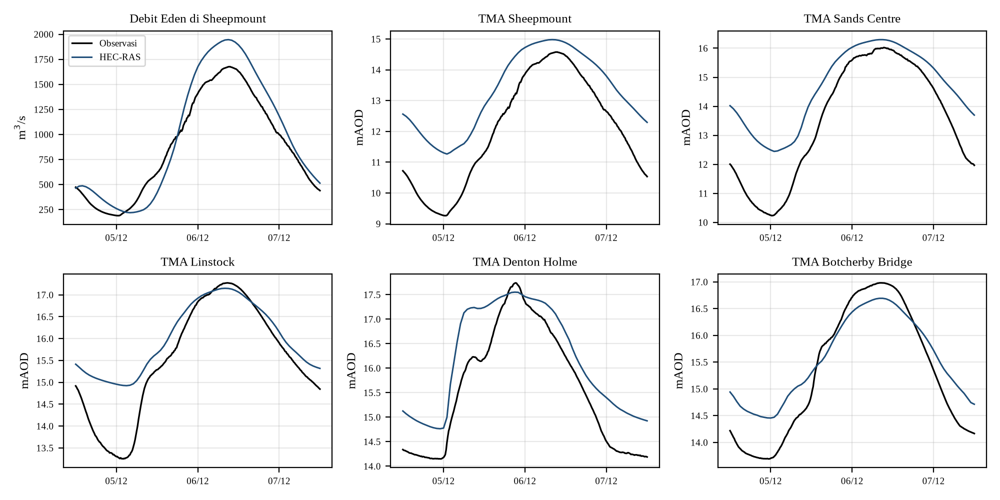
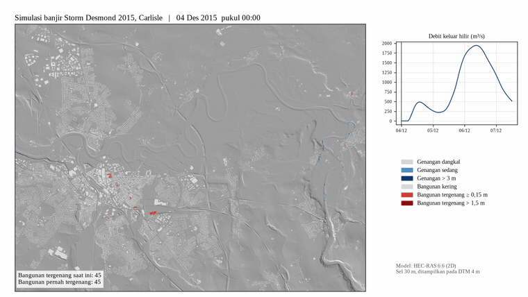

<div align="center">

# Simulasi Banjir HEC-HMS + HEC-RAS 2D: Studi Kasus Carlisle (Storm Desmond 2015)

**Uji konsep alur simulasi banjir untuk kawasan Sepaku, Ibu Kota Nusantara (IKN)**


-1f4e79)




*Animasi 3D genangan Storm Desmond di pusat kota Carlisle. Bangunan berubah merah saat tergenang (skala vertikal ×3).*

</div>

---

## English summary

This repository contains a complete, reproducible flood-modelling workflow (HEC-HMS rainfall-runoff → HEC-RAS 6.6 2D hydraulics → validation → design-flood scenario → 2D/3D visualisation) applied to the December 2015 Storm Desmond flood in Carlisle, UK. It was built as a proof of concept for a flood simulation system in Sepaku, Indonesia's new capital (IKN). The hydraulic model reproduces the observed peak flow at Sheepmount within +16% (NSE 0.86) and the official flood outline with a Critical Success Index of 0.80 in the urban area.

---

## Ringkasan

| | |
|---|---|
| **Kejadian** | Storm Desmond, 5–6 Desember 2015, Carlisle, Inggris |
| **Model hidrologi** | HEC-HMS 4.14, DAS Eden 2.286,5 km², 7 sub-DAS |
| **Model hidraulika** | HEC-RAS 6.6 2D, domain 38,9 km², mesh 30 m (42.634 sel), diffusion wave |
| **Validasi** | Debit, TMA 8 pos, dan batas genangan resmi Environment Agency |
| **Skenario** | Banjir kala ulang 100 tahun (T100) |
| **Visualisasi** | Peta bahaya, animasi 2D, animasi 3D, QGIS 3D |
| **Perangkat** | Laptop i7 gen 13, RAM 8 GB, tanpa GPU (1 jam 13 menit per simulasi) |

## Alur kerja



Model HEC-RAS untuk kejadian Desmond digerakkan oleh **debit terukur** di empat pos hulu, sehingga kesalahan model hidraulika dapat dinilai terpisah dari kesalahan model hidrologi. Untuk skenario T100, bentuk hidrograf berasal dari HEC-HMS dan besarnya disesuaikan dengan analisis frekuensi debit NRFA.

## Hasil utama

### Kriteria dan capaian

| Parameter | Kriteria | HEC-HMS (Sheepmount) | HEC-RAS 2D |
|---|---|---|---|
| Selisih debit puncak | ≤ ±20% | −7,8% ✅ | +16,1% ✅ |
| Selisih waktu puncak | ≤ ±1 jam | −1 jam ✅ | 0 jam ✅ |
| NSE debit | ≥ 0,7 | 0,87 ✅ | 0,86 ✅ |
| Selisih TMA puncak (8 pos) | ≤ ±0,3 m | – | −0,62 s.d. +0,40 m (4 pos lolos) |
| CSI genangan (zona kota) | ≥ 0,5 | – | 0,80 ✅ |
| Galat volume | < 1% | – | 0,0019% ✅ |

### Desmond 2015 vs skenario T100

| Parameter | Desmond 2015 | T100 |
|---|---|---|
| Debit keluar puncak model (m³/s) | 1.946 | 1.431 |
| Luas genangan total (km²) | 22,8 | 22,2 |
| Luas bahaya tinggi, kedalaman > 1,5 m (km²) | 13,8 | 11,3 |
| Bangunan tergenang ≥ 0,15 m | 1.137 | 1.057 |
| Bangunan dengan kedalaman > 1,5 m | 398 | 228 |

<p align="center">


</p>

<details>
<summary><b>Gambar lainnya (lokasi, kalibrasi, validasi)</b></summary>





</details>

### Animasi



Video resolusi penuh: [2D Desmond](media/animasi_2D_Desmond_2015.mp4) · [2D T100](media/animasi_2D_T100.mp4) · [3D Desmond](media/animasi_3D_Desmond_2015.mp4) · [3D T100](media/animasi_3D_T100.mp4)

## Pelajaran untuk IKN

1. **DEM tidak merekam dasar sungai.** LiDAR maupun DEMNAS merekam permukaan air, sehingga kapasitas alur sungai di model terlalu kecil dan muka air saat aliran rendah 1–2 m terlalu tinggi. Data penampang sungai perlu dipakai untuk memperbaiki alur di dalam medan model.
2. **Hujan rencana perlu dicek silang dengan frekuensi debit.** Debit T100 dari hujan rencana pos penakar hanya 957 m³/s, 39% lebih kecil dari analisis frekuensi debit terukur (1.563 m³/s), karena pos hujan di lembah tidak menangkap hujan orografis di pegunungan.
3. **Cek volume sebelum kalibrasi.** Membandingkan volume hujan dan volume aliran dapat mengungkap masalah data hujan sebelum parameter model diubah-ubah.
4. **Data kejadian banjir adalah kunci validasi.** Pencatatan TMA dan batas genangan saat banjir di Sepaku perlu dimulai sekarang.
5. **Komputasi terjangkau.** Satu kejadian dihitung kurang dari 1,5 jam di laptop biasa, sehingga pustaka skenario dapat disusun tanpa server khusus.

## Struktur repositori

```
carlisle-flood-hec/
├── docs/                    Laporan (PDF ringkas 5 hlm & lengkap 10 hlm) dan gambar
├── media/                   Animasi 2D/3D (MP4) dan pratinjau GIF
├── hec_models/
│   ├── hec-hms/             File teks proyek HEC-HMS (basin, met, control, gage, run)
│   └── hec-ras/             File teks proyek HEC-RAS (prj, g01, u01, u02, p01, p02, rasmap)
├── data/
│   ├── inputs/              Debit & TMA terukur, hidrograf masukan, hujan rencana, frekuensi debit
│   └── gis/                 Shapefile area 2D, garis batas (BC), titik TMA, tanggul
├── results/
│   ├── desmond_2015/        Peta bahaya (kelas 1–3 kedalaman; H1–H6), bangunan terdampak, evaluasi
│   └── t100/                Peta bahaya dan bangunan terdampak skenario T100
└── src/
    ├── 01_data_preparation/ Unduh & olah data (DAS, LiDAR, hidrometeorologi, lahan, input model)
    ├── 02_hec_files/        Penulisan file geometri dan aliran HEC-RAS
    ├── 03_evaluation/       Evaluasi NSE, CSI, peta bahaya, bangunan terdampak
    └── 04_visualization/    Gambar laporan, animasi 2D dan 3D, layer QGIS 3D
```

## Cara mereproduksi

**Prasyarat:** Python 3.12, [HEC-HMS 4.14](https://www.hec.usace.army.mil/software/hec-hms/), [HEC-RAS 6.6](https://www.hec.usace.army.mil/software/hec-ras/), QGIS (opsional).

```bash
git clone https://github.com/muhshandy-dev/carlisle-flood-hec.git
cd carlisle-flood-hec
pip install -r requirements.txt
```

1. **Siapkan data.** Jalankan skrip di `src/01_data_preparation/` berurutan (`01_das.py` sampai `06_kalibrasi_emulator.py`). Hasilnya tersimpan di folder `paket/`. Dua berkas yang diunduh manual, yaitu Recorded Flood Outlines dan Spatial Flood Defences, diletakkan di `probe/` (lihat [Sumber data](#sumber-data)).
2. **HEC-HMS.** Buka `hec_models/hec-hms/Carlisle_Eden.hms`, sesuaikan lokasi file DSS di `Carlisle_Eden.gage`, lalu jalankan `Run_Desmond` dan `Run_T100`.
3. **HEC-RAS 2D.** Buat proyek baru, atur proyeksi EPSG:27700, buat terrain dari `dtm_2m_carlisle_dengan_tanggul.tif` dan land cover dari `tutupan_lahan_2m_domain2d.tif`, lalu salin file teks dari `hec_models/hec-ras/` ke folder proyek. Langkah lengkapnya ada di laporan.
4. **Evaluasi dan visualisasi.**
   ```bash
   python src/03_evaluation/evaluasi_hasil_hec.py --paket paket --kejadian desmond_2015 \
       --kedalaman "<RAS>/Demond/Depth (Max)...tif" --kecepatan "<RAS>/Demond/Velocity (Max)...tif" \
       --wse "<RAS>/Demond/WSE (Max)...tif" --keluar out/hasil_desmond
   python src/04_visualization/anim.py <RAS>/Carlisle.p01.hdf desmond "Storm Desmond 2015" x
   ```
   Lokasi folder dapat diatur dengan variabel lingkungan `RAS_DIR`, `HMS_DIR`, `PAKET_DIR`, dan `OUT_DIR`.

Raster hasil berukuran besar (kedalaman maksimum 2 m dan muka air 3D) tidak disimpan di repositori ini dan dapat dibuat ulang dari model.

## Sumber data

Semua data bersifat terbuka. Detail stasiun dan link API ada di [`data/README.md`](data/README.md).

| Data | Penyedia | Link |
|---|---|---|
| LiDAR DTM & DSM 1 m | Environment Agency | [DTM](https://environment.data.gov.uk/dataset/13787b9a-26a4-4775-8523-806d13af58fc) · [DSM](https://environment.data.gov.uk/dataset/df4e3ec3-315e-48aa-aaaf-b5ae74d7b2bb) |
| Hujan, debit, TMA 15 menit | Environment Agency | [Hydrology Data Explorer](https://environment.data.gov.uk/hydrology/) |
| Batas DAS, debit puncak tahunan | UKCEH NRFA | [NRFA](https://nrfa.ceh.ac.uk/data/search) |
| Tanggul dan dinding banjir | Environment Agency | [Spatial Flood Defences](https://environment.data.gov.uk/dataset/8e5be50f-d465-11e4-ba9a-f0def148f590) |
| Batas genangan tercatat | Environment Agency | [Recorded Flood Outlines](https://ckan.publishing.service.gov.uk/dataset/recorded-flood-outlines1) |
| Tutupan lahan 10 m | ESA | [WorldCover 2021 v200](https://esa-worldcover.org/) |
| Tekstur tanah | ISRIC | [SoilGrids](https://soilgrids.org/) |
| Bangunan, sungai, jalan | Ordnance Survey | [OS OpenMap Local](https://osdatahub.os.uk/downloads/open/OpenMapLocal) |

## Keterbatasan

Kalibrasi hanya memakai satu kejadian. HEC-HMS belum akurat di sub-DAS hulu. Sub-DAS Lokal Carlisle belum dimasukkan ke model hidraulika. Bangunan hanya diwakili melalui nilai kekasaran. Penskalaan debit T100 adalah pendekatan praktis yang belum menggantikan perbaikan data hujan.

## Laporan

- [Laporan ringkas (5 halaman)](docs/Laporan_Carlisle_HEC_ringkas.pdf)
- [Laporan lengkap (10 halaman)](docs/Laporan_Carlisle_HEC_lengkap.pdf)

## Penulis

**Muhammad Shandy Alfarizal**
Asisten Analis Data Ilmiah (MagangHub), Direktorat Data dan Kecerdasan Buatan, Deputi Bidang Transformasi Hijau dan Digital, Otorita Ibu Kota Nusantara.

## Lisensi

Kode di folder `src/` dirilis dengan lisensi [MIT](LICENSE). Data mengikuti lisensi masing-masing penyedia: Open Government Licence v3.0 (Environment Agency, Ordnance Survey, UKCEH) dan CC BY 4.0 (ESA WorldCover, SoilGrids). Hasil turunan mencantumkan atribusi: © Environment Agency copyright and/or database right; contains OS data © Crown copyright and database right; © UKCEH NRFA; © ESA WorldCover project.
